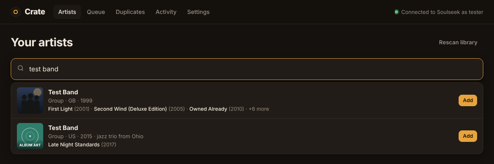
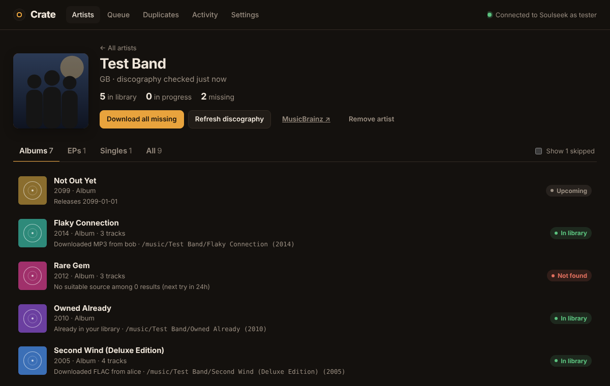
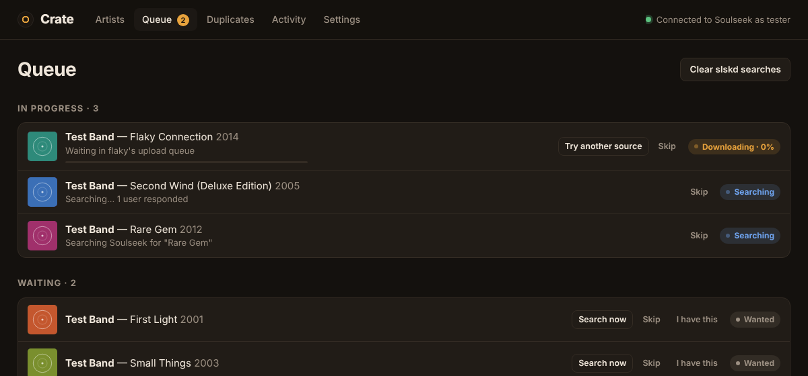
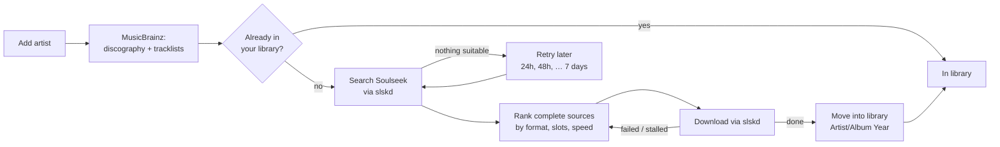
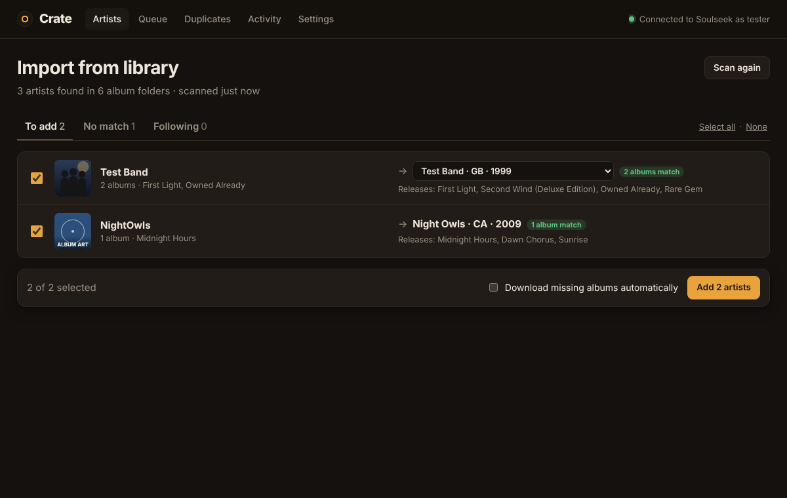
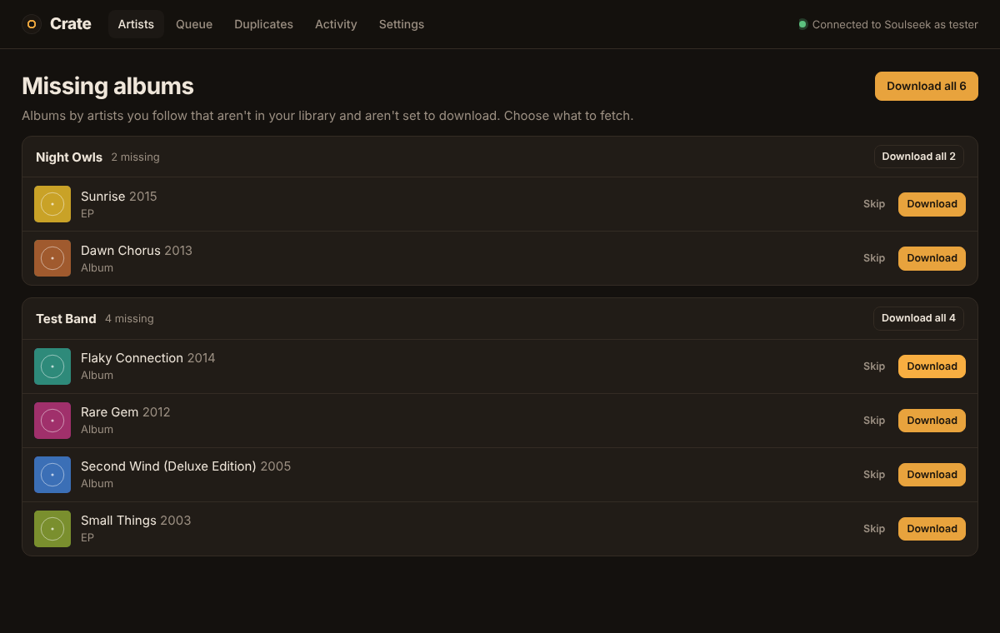
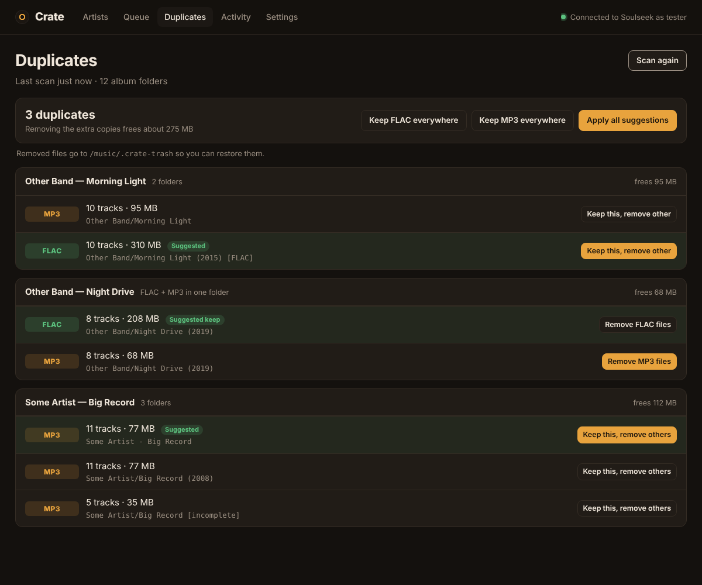

# Crate

**Follow music artists and Crate fetches their discographies for you, through [slskd](https://github.com/slskd/slskd) (Soulseek).**

Add an artist and Crate pulls their full list of releases from MusicBrainz. It checks which albums are already in your music folder, then searches Soulseek through slskd for the rest. It picks the best complete copy of each album, downloads it, and files it into your library. After that it keeps watching for new releases.



| Artist page | Queue |
|---|---|
|  |  |

<sub>Screenshots use demo data.</sub>

---

## Contents

- [Features](#features)
- [How it works](#how-it-works)
- [Requirements](#requirements)
- [Docker setup: Crate + slskd together](#docker-setup-a-crate--slskd-together)
- [Docker setup: Crate with an slskd you already run](#docker-setup-b-crate-with-an-slskd-you-already-run)
- [How the folders fit together](#how-the-folders-fit-together)
- [Running without Docker](#running-without-docker)
- [Using Crate](#using-crate)
- [Importing the music you already have](#importing-the-music-you-already-have)
- [How Crate picks a download](#how-crate-picks-a-download)
- [Duplicate scanner](#duplicate-scanner)
- [Configuration reference](#configuration-reference)
- [Updating, logs and backups](#updating-logs-and-backups)
- [Troubleshooting](#troubleshooting)
- [Notes](#notes)
- [Development](#development)

---

## Features

- **Import your existing collection.** Crate scans your music folder, finds the artists in it, matches each one on MusicBrainz, and lets you add them all at once. It then lists the albums you're missing, so you choose what to download.
- **Follow artists.** Search MusicBrainz from the web UI. Each result shows the artist's photo (from Wikidata) or album art, plus a few of their albums, so you can pick the right artist when several share a name.
- **Full discographies.** Crate gets every release from MusicBrainz. You choose which types to follow: albums and EPs by default. Singles, live albums and compilations are skipped unless you turn them on, and you can always download or skip individual releases.
- **Never downloads what you already have.** Crate scans your music folder, using folder names and, when available, tags, and marks matching albums **In library**.
- **Smart source picking.** Folders that are incomplete, at too low a bitrate, or have a tracklist that doesn't match the album are rejected. Of the rest, Crate prefers your best format, a free upload slot and a fast connection. If a source fails or stalls, it moves to the next one automatically.
- **Tidy library.** Finished albums are moved to `Artist/Album (Year)/`, with multi-disc albums kept in their `CD1`/`CD2` folders and the cover image included. You can change the folder layout.
- **Keeps up to date.** Artists are re-checked every 24 hours for new releases. Albums that weren't found are retried later, waiting longer each time.
- **Gentle on Soulseek.** Crate only searches while slskd is logged in, leaves a gap of at least 8 seconds between searches, and backs off if a search is rejected. **Clear slskd searches** tidies slskd's search list.
- **Duplicate scanner.** Finds albums you have more than once, either in separate folders or as FLAC and MP3 copies in one folder. You keep one copy, or remove one format. Removed files go to a trash folder you can restore from.
- **Lightweight.** Plain Python with no required packages. State lives in a single SQLite file, and there's one small web UI on port **9325**.

## How it works



Crate never talks to the Soulseek network itself: everything goes through slskd's API. slskd handles the Soulseek login, searches, transfers and sharing.

## Requirements

- A **Soulseek account.** Any new username/password pair is registered automatically the first time slskd logs in with it.
- **Docker with the Compose plugin** (recommended), or **Python 3.10+**.
- A folder for your music library, and some disk space for downloads.

Please **share music back.** Soulseek runs on people sharing, and many users won't upload to people who share nothing. The Crate + slskd setup below shares your library read-only by default.

---

## Docker setup A: Crate + slskd together

Use this if you don't run slskd yet. One compose file starts both, already connected to each other.

Crate runs from a prebuilt image (`ghcr.io/xxsmack003xx/crate`, for amd64 and arm64 machines such as a Raspberry Pi), so you only need two files: the compose file and the settings file.

**1. Download the compose file and settings template**

```bash
mkdir crate && cd crate
curl -fsSL -o docker-compose.yml https://raw.githubusercontent.com/XxSmack003xX/crate/main/docker-compose.yml
curl -fsSL -o .env https://raw.githubusercontent.com/XxSmack003xX/crate/main/.env.example
```

Or clone the repo with `git clone https://github.com/XxSmack003xX/crate.git && cd crate && cp .env.example .env`.

**2. Fill in your settings**

Open `.env` and fill in:

| Setting | What to put |
|---|---|
| `MUSIC_DIR` | Full path to your music library, e.g. `/home/you/Music` or `/mnt/media/music` |
| `DOWNLOADS_DIR` | Leave as `./downloads`, or any empty folder |
| `PUID` / `PGID` | Your user and group IDs. Run `id`; usually `1000` / `1000` |
| `SLSKD_API_KEY` | A long random string. Make one with `openssl rand -hex 24` |
| `SOULSEEK_USERNAME` / `SOULSEEK_PASSWORD` | Your Soulseek login |
| `SLSKD_WEB_USERNAME` / `SLSKD_WEB_PASSWORD` | A login for slskd's own web page. Change the defaults. |
| `MB_CONTACT` | An email or URL, which MusicBrainz asks API users to send |
| `CRATE_VERSION` | Leave as `latest`, or pin a version like `1.1.0` |

**3. Create the data folders and start**

```bash
mkdir -p downloads crate-data slskd
docker compose up -d
```

Creating the folders yourself first means they're owned by you and not by root.

**4. Check slskd**

Open **http://localhost:5030**, sign in with the web login you chose, and check that the top bar shows slskd as connected and logged in to Soulseek.

**5. Open Crate**

Go to **http://localhost:9325 → Settings → Test connection & folders**. All three lines should be green. Then go to **Artists** and add someone, or click **Import from library** to follow everyone already in your music folder.

**Optional: forward the Soulseek port.** Forward TCP **50300** (`SLSKD_LISTEN_PORT`) on your router to this machine. Without it, you can still download from most people, but users behind closed ports can't connect to you.

#### What this setup creates

| Container | Port | Volumes |
|---|---|---|
| `slskd` | 5030 (web UI), 50300 (Soulseek) | `./slskd` → slskd config & database · `DOWNLOADS_DIR` → `/downloads` · `MUSIC_DIR` → `/music` (read-only, shared) |
| `crate` | 9325 | `./crate-data` → Crate's database · `DOWNLOADS_DIR` → `/downloads` · `MUSIC_DIR` → `/music` |

---

## Docker setup B: Crate with an slskd you already run

Use this if slskd is already running, in Docker, natively, or on another machine. You'll start only the Crate container, using `docker-compose.existing-slskd.yml`.

**1. Download the compose file and settings template**

```bash
mkdir crate && cd crate
curl -fsSL -o docker-compose.yml https://raw.githubusercontent.com/XxSmack003xX/crate/main/docker-compose.existing-slskd.yml
curl -fsSL -o .env https://raw.githubusercontent.com/XxSmack003xX/crate/main/.env.example
mkdir -p crate-data
```

The file is saved as `docker-compose.yml`, so plain `docker compose` commands work. If you cloned the repo instead, add `-f docker-compose.existing-slskd.yml` to each command.

**2. Give slskd an API key**

Pick one of these, then restart slskd:

- **Environment variable** on the slskd container. This gives the key full access:
  ```yaml
  environment:
    - SLSKD_API_KEY=a-long-random-string-at-least-16-chars
  ```
- **Or in `slskd.yml`** (in slskd's app/data folder):
  ```yaml
  web:
    authentication:
      api_keys:
        crate:
          key: a-long-random-string-at-least-16-chars
          role: ReadWrite
  ```

Put the same key in Crate's `.env` as `SLSKD_API_KEY`.

**3. Point Crate at slskd**

Set `SLSKD_URL` in `.env` to the address of slskd *as seen from inside the Crate container*:

| Where slskd runs | `SLSKD_URL` |
|---|---|
| This machine, natively or in Docker with port 5030 published | `http://host.docker.internal:5030` (the default) |
| Another machine on your network | `http://192.168.1.50:5030` (its IP) |
| A Docker container on a network Crate joins (see below) | `http://slskd:5030` (its container name) |

To join slskd's Docker network instead of going through the host, find its name with `docker network ls`. It's often `<folder>_default`. Then uncomment the `networks:` lines at the bottom of `docker-compose.existing-slskd.yml`.

**4. Point Crate at slskd's downloads folder.** This is the important step.

Crate needs to see the files slskd downloads so it can move them into your library. Set `DOWNLOADS_DIR` to the **host folder** where your slskd saves completed downloads:

- **slskd in Docker:** the host side of its downloads volume. If slskd's compose has `- /srv/slskd/downloads:/app/downloads`, use `DOWNLOADS_DIR=/srv/slskd/downloads`. You can check with `docker inspect slskd --format '{{json .Mounts}}'`.
- **slskd installed natively:** its `directories.downloads` setting. The default is a `downloads` folder inside slskd's app directory, e.g. `~/.local/share/slskd/downloads`.
- **slskd on another machine:** that folder has to be reachable from this machine, for example as an NFS or SMB share mounted locally. Use the local mount path. Otherwise, run Crate on the same machine as slskd.

Also set `MUSIC_DIR`, `PUID`/`PGID` and `MB_CONTACT` as in setup A.

**5. Start Crate**

```bash
docker compose up -d
```

Open **http://localhost:9325 → Settings → Test connection & folders**. All three lines should be green. Already have a collection? Use **Artists → Import from library**.

> Crate needs permission to **delete** files from slskd's downloads folder (it moves them out) and to **write** to your music folder. Set `PUID`/`PGID` to the user that owns those folders.

---

## How the folders fit together

Both containers see the same folders on your disk, mounted at fixed paths inside each container:

```
your disk                     slskd container        Crate container
─────────────────────────     ───────────────        ───────────────
DOWNLOADS_DIR  ─────────────▶ /downloads  (writes)   /downloads  (moves files out)
MUSIC_DIR      ─────────────▶ /music      (shares)   /music      (files albums in, scans)
./crate-data   ─────────────────────────────────────▶ /data       (crate.db)
```

The compose files already point Crate at `/downloads` and `/music`, so you only edit `.env`. If you change folder paths later in Crate's **Settings** page, use paths **inside the container** (`/downloads`, `/music`), not the paths on your disk.

## Running without Docker

```bash
git clone https://github.com/XxSmack003xX/crate.git
cd crate
python3 -m crate                 # → http://localhost:9325
# options:  --port 9325  --host 0.0.0.0  --db ./data/crate.db
```

Then fill in **Settings**: the slskd address (e.g. `http://localhost:5030`), the API key, slskd's downloads folder and your music folder, as normal paths on this machine.

Optional: `pip install mutagen` lets Crate read tags and bitrates in your existing library. The Docker image includes it. Without it, Crate recognises albums by folder name, such as `Artist/Album`, `Artist/2001 - Album [FLAC]` or `Artist - Album`.

To run it in the background on Linux, wrap it in a systemd service, or just use the Docker setup.

---

## Using Crate

| Page | What you can do |
|---|---|
| **Artists** | Search and add artists, see how complete each discography is, **Rescan library** after adding music by hand, and **Import from library**. A banner links to **Missing albums** when there are albums waiting for you to choose. |
| **Import from library** | Follow the artists already in your music folder. See [below](#importing-the-music-you-already-have). |
| **Missing albums** | Albums by artists you follow that you don't have and that aren't set to download, grouped by artist. **Download** one, **Download all** for an artist, **Download all** overall, or **Skip**. |
| **Artist page** | Tabs for Albums, EPs, Singles and Other. **Download all missing**, **Refresh discography**, and per-release **Download**, **Skip**, **Search again**, **Try another source** and **I have this** (re-checks your library for that album). |
| **Queue** | Everything searching or downloading, with live progress, plus what's waiting or not found. **Clear slskd searches** deletes finished searches from slskd's Searches page; running searches are kept. |
| **Duplicates** | Find and clean up albums you have more than once. See [Duplicate scanner](#duplicate-scanner). |
| **Activity** | A log of everything Crate did and why: which source it picked, which ones failed, what was imported, connection problems. |
| **Settings** | Connection, folders, release types, formats and bitrate, how many searches and downloads run at once, timeouts, and what happens to removed duplicates. |

Removing an artist never deletes files from disk.

## Importing the music you already have



**Artists → Import from library → Scan music folder.**

1. **Crate scans your library.** It reads artist and album names from the folders (`Artist/Album`, `Artist - Album`, `Artist/2001 - Album [FLAC]`, multi-disc `CD1`/`CD2` folders), or from tags when `mutagen` is installed. "Various Artists" and loose files are skipped.
2. **Each artist is matched on MusicBrainz.** When several artists share a name, Crate picks the one whose releases include the albums you have. It also handles folder names that don't exactly match, like `NightOwls` for *Night Owls*. Each match is labelled:
   - **N albums match**: your albums are among this artist's releases. Ticked.
   - **Name match**: the only artist with exactly this name. Ticked.
   - **Check this**: same-name artists, or only a rough match. Not ticked; use the dropdown to choose the right artist.
   - **No match**: nothing found. Rename the folder, or add the artist from the Artists search.
3. **Review and add.** Untick anyone you don't want, change a match with the dropdown, then click **Add N artists**. Matching runs at about one artist every two seconds (MusicBrainz's rate limit), and you can start reviewing while it works.
4. **Choose what to download.** Imported artists **don't auto-download** unless you tick *Download missing albums automatically*. Albums you already have show as **In library**, and the rest go to **Missing albums**, where you can download them one at a time, per artist, or all at once.



Crate remembers each artist's folder name, so albums stored under a different spelling (e.g. `AC_DC` for *AC/DC*) are still recognised as yours. It never moves or renames the music you already have. Running the scan again shows artists you already follow under **Following** and only offers new ones.

### Album statuses

| Status | Meaning |
|---|---|
| In library | It's on disk, either because you already had it or because Crate downloaded it |
| Wanted | Waiting for a search slot |
| Searching | A Soulseek search is collecting results |
| Source found | Matching sources were found and the album is waiting for a download slot |
| Downloading | Shows progress, or "Waiting in X's upload queue" |
| Not found | No good source yet; it will be retried automatically |
| Failed | The download finished but couldn't be imported (usually the downloads-folder setting) |
| Skipped | A release type you don't follow, or one you skipped |
| Missing | Not in your library and not set to download, e.g. from an imported artist, or with auto-download off. Listed under **Missing albums**; click **Download** |
| Upcoming | The release date is in the future; it will be searched once it's out |

## How Crate picks a download

Crate searches for `Artist Album`. If that finds nothing usable, it tries the album title alone, and still checks the artist against the folder path. For each search result, files are grouped by user and folder. Multi-disc albums split into `CD1`/`CD2` folders count as one album. A folder is **rejected** if:

- it has fewer audio files than the album has tracks, or far more than expected
- the album title isn't in the folder name, or the artist isn't anywhere in the path
- the filenames don't match the real tracklist from MusicBrainz, which filters out a different album that happens to have the right track count
- it isn't in one of your formats (default `flac,mp3`), or it's an MP3 below your minimum bitrate (default 256 kbps)
- it has locked files, or it comes from a user who already failed for this album

Folders that pass are ranked by format (in your order of preference), how well the tracklist matches, whether the user has a free upload slot, queue length and upload speed.

**When things go wrong.** If files fail, Crate retries them once from the same user. If they fail again, or a download makes no progress for 30 minutes (including waiting in the user's queue), Crate cancels it and moves to the next-best source. When every source has failed, the album is marked **Not found** and searched again after 24h, then 48h, and so on, up to once a week.

**Being polite to Soulseek.** Crate only searches while slskd is logged in to Soulseek. If slskd disconnects, Crate pauses all searches and downloads, shows a banner, and resumes by itself when slskd reconnects. Searches are spaced at least 8 seconds apart. If slskd rejects a search, Crate pauses new searches for 5 minutes, doubling up to 30 if it keeps happening, and never retries in a tight loop.

## Duplicate scanner



**Duplicates → Scan library** finds two kinds of duplicate:

- **The same album in two or more folders,** e.g. `Morning Light (2015) [FLAC]` and `Morning Light`. Click **Keep this, remove other** on the copy you want.
- **One folder holding both FLAC and MP3 copies of the tracks.** Click **Remove MP3 files** or **Remove FLAC files**.

There are also bulk buttons: **Keep FLAC everywhere**, **Keep MP3 everywhere** and **Apply all suggestions**. Albums without a copy in the chosen format are left alone. The suggested copy, highlighted in green, is always a complete one, then the format you rank first in Settings, then the higher bitrate.

Albums are matched by artist and title, ignoring years, `[FLAC]`-style tags and bracketed extras. That means `Album` and `Album (Deluxe Edition)` count as the same album, so check the list before using a bulk button. Removed files go to `<library>/.crate-trash/` so you can restore them, until you click **Empty trash**. You can switch to permanent deletion in Settings. If a removed copy was one Crate downloaded, Crate's record of that album points at the copy you kept.

## Configuration reference

Every setting can be changed in the web UI. Settings can also be preset with environment variables named `CRATE_<NAME>` (e.g. `CRATE_MIN_BITRATE=320`). Values saved in the UI take priority.

| Setting | Default | |
|---|---|---|
| `slskd_url` | `http://localhost:5030` | |
| `slskd_api_key` | | |
| `slskd_downloads_dir` | `./downloads` (`/downloads` in Docker) | slskd's completed-downloads folder, as Crate sees it |
| `library_dir` | `./music` (`/music` in Docker) | |
| `import_mode` | `move` | `move`, `copy` or `off` (leave files in the downloads folder) |
| `folder_template` | `{artist}/{album} ({year})` | You can also use `{type}` |
| `dupes_action` | `trash` | `trash` (move to `<library>/.crate-trash`) or `delete` |
| `release_types` | `album,ep` | Any of `album,ep,single,broadcast,other` |
| `exclude_secondary` | `compilation,live,remix,…` | MusicBrainz secondary types to skip |
| `auto_download` | `true` | If `false`, missing albums wait for you to click Download. Artists added through **Import from library** use the choice made on that page instead. |
| `preferred_formats` | `flac,mp3` | Best first; formats not listed are never downloaded |
| `min_bitrate` | `256` | kbps, for lossy formats |
| `search_timeout` | `45` | seconds |
| `max_active_searches` | `2` | |
| `max_active_downloads` | `3` | albums downloading at once |
| `stall_minutes` | `30` | |
| `retry_hours` | `24` | |
| `sync_hours` | `24` | how often to check artists for new releases |
| `mb_contact` | | an email or URL for the MusicBrainz User-Agent |

Process options (environment only): `CRATE_PORT` (`9325`), `CRATE_HOST` (`0.0.0.0`), `CRATE_DB` (`./data/crate.db`, `/data/crate.db` in Docker) and `CRATE_SEARCH_SPACING` (`8` seconds).

In Docker, the published port is set by `CRATE_PORT` in `.env`. The app inside the container always listens on 9325.

---

## Updating, logs and backups

**Update to the latest version:**

```bash
docker compose pull
docker compose up -d
```

Your artists, settings and database carry over, and any database changes are applied automatically when Crate starts. To stay on a specific version, set `CRATE_VERSION=1.1.0` in `.env`. To go back to a version, set it and run the same two commands. Available versions are listed on the [package page](https://github.com/XxSmack003xX/crate/pkgs/container/crate).

| Image tag | What it is |
|---|---|
| `latest` | The newest release, or the newest code on `main` |
| `1.1.0`, `1.1`, `1` | A specific release / the newest release in that series |
| `main`, `sha-abc1234` | Builds of the `main` branch |

```bash
docker compose logs -f crate        # follow Crate's log
```

Building from source instead: clone the repo, uncomment `build: .` in the compose file, and run `docker compose up -d --build`. After `git pull`, run the same command to rebuild.

Everything Crate knows (artists, album states, settings) is in `crate-data/crate.db`. Back up that one file. Your music and the slskd config live in their own folders.

## Troubleshooting

| Symptom | Fix |
|---|---|
| Banner: *"slskd isn't logged in to the Soulseek network"* | Check the Soulseek username and password in slskd. If you just made hundreds of searches, the server may have disconnected you for a while; wait and slskd will reconnect. Crate resumes by itself. |
| *"slskd rejected the API key (401)"* | The key in Crate's `.env` or Settings doesn't match slskd's. Keys must be 16+ characters. Restart slskd after changing its key. |
| *"Can't reach slskd at …"* | `SLSKD_URL` is wrong for where slskd runs. See the table in [setup B](#docker-setup-b-crate-with-an-slskd-you-already-run). From inside a container, `localhost` means the container itself, not your computer. |
| Album **Failed**: *"files weren't found under /downloads"* | Crate isn't seeing slskd's downloads folder. Make sure both containers mount the **same host folder** (`DOWNLOADS_DIR`), then click **Search again**. |
| *Permission denied* when importing | Set `PUID`/`PGID` in `.env` to the owner of your music and downloads folders, then run `docker compose up -d` again. |
| Crate container keeps restarting, can't open database | `crate-data` was created by Docker as root. Run `sudo chown -R $(id -u):$(id -g) crate-data`. |
| Everything is **Not found** | Try `preferred_formats` = `flac,mp3,m4a`, lower `min_bitrate`, or a longer `search_timeout`. Rare music may simply not be shared right now. Crate retries later. |
| No artist pictures | Not every artist has a photo on Wikidata, so Crate shows album art instead. Pictures load in your browser, so it needs internet access. |
| Import picked the wrong artist | Change it with the dropdown on that row before adding. If you already added it, remove the artist (files are kept) and add the right one from the search. |
| Import says *No match* | The folder name isn't an artist name MusicBrainz knows. Rename the folder (e.g. `Artist/Album`), or add the artist from the Artists search. |
| Already-owned albums get downloaded again | Crate matches by folder name or tags. Use **I have this** on the album, or rename the folder to `Artist/Album`. Installing `mutagen` (included in Docker) improves matching. |

## Notes

- Crate has **no login**. Keep it on your home network, or put it behind a reverse proxy with authentication if it's reachable from the internet.
- MusicBrainz allows about one request per second, so adding an artist with a large discography takes a few seconds. Each album's tracklist is fetched just before it's searched.
- Artist pictures come from Wikidata / Wikimedia Commons through the artist's MusicBrainz page. Album art comes from the Cover Art Archive.
- Use Crate for music you have the right to download. You're responsible for complying with copyright law where you live.

## Development

```
crate/
  core.py      engine: artist sync, search → pick → download → import
  matcher.py   ranks slskd search results
  slskd.py     slskd API client
  mb.py        MusicBrainz / Wikidata client
  library.py   library scan & "already have it" matching
  dupes.py     duplicate scanner
  importer.py  import artists from your existing library
  server.py    HTTP API
  web/         single-page UI
tests/
  mock_services.py   fake MusicBrainz + slskd
  test_e2e.py        full pipeline test
  test_dupes.py      duplicate scanner test
  test_import.py     library import test
```

```bash
python3 tests/test_e2e.py && python3 tests/test_dupes.py && python3 tests/test_import.py
```

No network or real slskd is needed. The tests run against fake services.

## License

[MIT](LICENSE)
