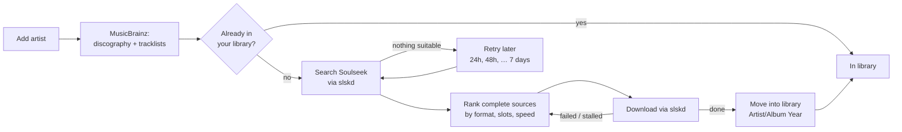
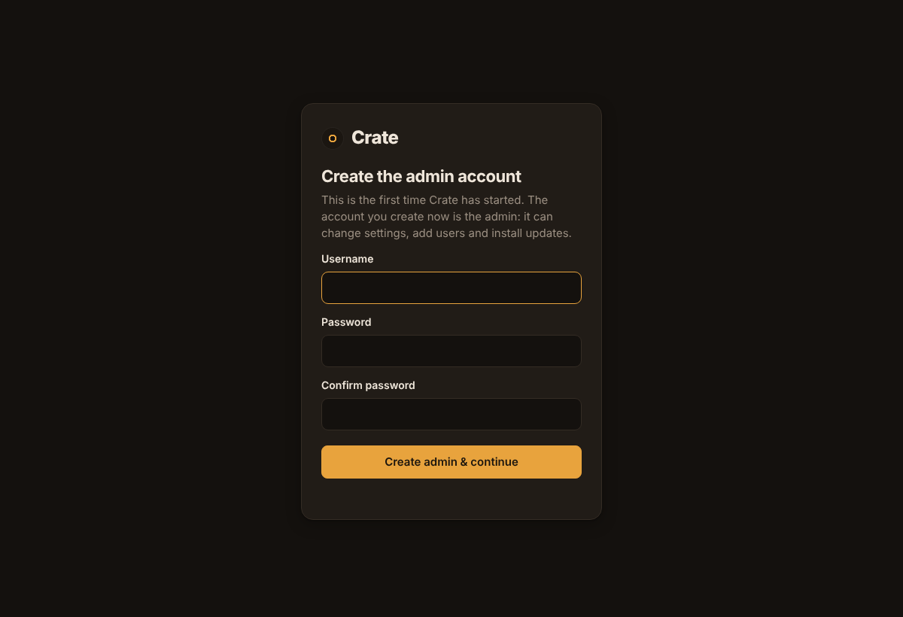
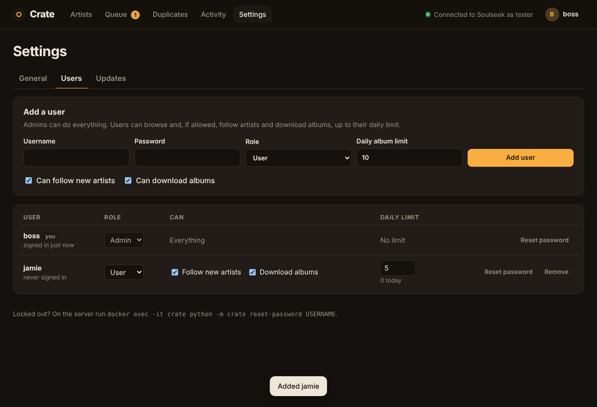
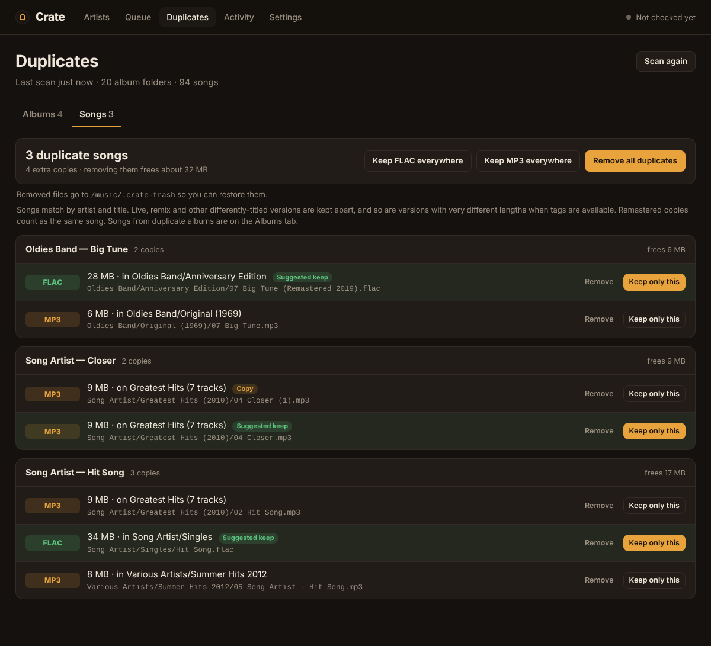
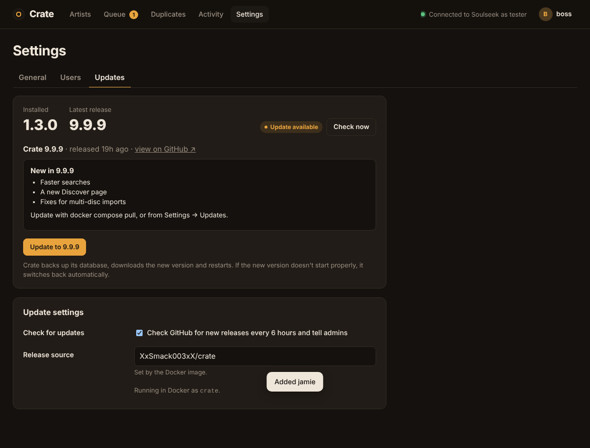

# Crate

**Follow music artists and Crate fetches their discographies for you, through [slskd](https://github.com/slskd/slskd) (Soulseek).**

Add an artist and Crate pulls their full list of releases from MusicBrainz. It checks which albums are already in your music folder, then searches Soulseek through slskd for the rest. It picks the best complete copy of each album, downloads it, and files it into your library. After that it keeps watching for new releases.


| Artist page | Queue |
|---|---|
|  |  |

<sub>Screenshots use demo data.</sub>

---

## Contents

- [Features](#features)
- [How it works](#how-it-works)
- [Requirements](#requirements)
- [Docker setup: Crate + slskd together](#docker-setup-a-crate--slskd-together)
- [Docker setup: Crate with an slskd you already run](#docker-setup-b-crate-with-an-slskd-you-already-run)
- [How the folders fit together](#how-the-folders-fit-together)
- [Running without Docker](#running-without-docker)
- [Accounts and permissions](#accounts-and-permissions)
- [Using Crate](#using-crate)
- [Choosing what to fetch](#choosing-what-to-fetch)
- [Importing the music you already have](#importing-the-music-you-already-have)
- [Discover: recommendations](#discover-recommendations)
- [How Crate picks a download](#how-crate-picks-a-download)
- [Duplicate scanner](#duplicate-scanner)
- [Configuration reference](#configuration-reference)
- [Updating, logs and backups](#updating-logs-and-backups)
- [Troubleshooting](#troubleshooting)
- [Notes](#notes)
- [Development](#development)

---

## Features

- **Import your existing collection.** Crate scans your music folder, finds the artists in it, matches each one on MusicBrainz, and lets you add them all at once. It then lists the albums you're missing, so you choose what to download.
- **Follow artists.** Search MusicBrainz from the web UI. Each result shows the artist's photo (from Wikidata) or album art, plus a few of their albums, so you can pick the right artist when several share a name.
- **Full discographies.** Crate gets every release from MusicBrainz. You choose which types to follow: albums and EPs by default. Singles, live albums and compilations are skipped unless you turn them on, and you can always download or skip individual releases.
- **Rules per artist.** Each artist can have its own release types, include or leave out live albums and compilations, and turn auto-download on or off. Follow **only new releases** to skip an artist's back catalogue.
- **Recommendations.** The **Discover** page suggests artists similar to the ones you follow, from ListenBrainz (and Last.fm if you add a free key), ranked by how many of your artists they're like. Add them in one click. Each artist's page also shows **Fans also like**.
- **One-off albums.** Search for an album and get just that one, without following the artist. You can follow them later.
- **Never downloads what you already have.** Crate scans your music folder, using folder names and, when available, tags, and marks matching albums **In library**.
- **Smart source picking.** Folders that are incomplete, at too low a bitrate, or have a tracklist that doesn't match the album are rejected. Of the rest, Crate prefers your best format, a free upload slot and a fast connection. If a source fails or stalls, it moves to the next one automatically.
- **Tidy library.** Finished albums are moved to `Artist/Album (Year)/`, with multi-disc albums kept in their `CD1`/`CD2` folders and the cover image included. You can change the folder layout.
- **Keeps up to date.** Artists are re-checked every 24 hours for new releases. Albums that weren't found are retried later, waiting longer each time.
- **Gentle on Soulseek.** Crate only searches while slskd is logged in, leaves a gap of at least 8 seconds between searches, and backs off if a search is rejected. **Clear slskd searches** tidies slskd's search list.
- **Duplicate scanner.** Finds albums you have more than once, either in separate folders or as FLAC and MP3 copies in one folder, and duplicate songs, like `Song (1).mp3` or the same track on an album and as a single. Remove any copy, keep one, or clean up everything in one click. Removed files go to a trash folder you can restore from.
- **Accounts.** Sign-in with admins and users. Users can be allowed to follow artists and download albums, with a daily album limit, and everything else is admin-only.
- **One-click updates.** Crate checks GitHub for new releases and shows what's new. Admins update from **Settings → Updates**: Crate backs up its database, swaps to the new version, and switches back automatically if it doesn't start properly.
- **Lightweight.** Plain Python with no required packages. State lives in a single SQLite file, and there's one small web UI on port **9325**.

## How it works



Crate never talks to the Soulseek network itself: everything goes through slskd's API. slskd handles the Soulseek login, searches, transfers and sharing.

## Requirements

- A **Soulseek account.** Any new username/password pair is registered automatically the first time slskd logs in with it.
- **Docker with the Compose plugin** (recommended), or **Python 3.10+**.
- A folder for your music library, and some disk space for downloads.

Please **share music back.** Soulseek runs on people sharing, and many users won't upload to people who share nothing. The Crate + slskd setup below shares your library read-only by default.

---

## Docker setup A: Crate + slskd together

Use this if you don't run slskd yet. One compose file starts both, already connected to each other.

Crate runs from a prebuilt image (`ghcr.io/xxsmack003xx/crate`, for amd64 and arm64 machines such as a Raspberry Pi), so you only need two files: the compose file and the settings file.

**1. Download the compose file and settings template**

```bash
mkdir crate && cd crate
curl -fsSL -o docker-compose.yml https://raw.githubusercontent.com/XxSmack003xX/crate/main/docker-compose.yml
curl -fsSL -o .env https://raw.githubusercontent.com/XxSmack003xX/crate/main/.env.example
```

Or clone the repo with `git clone https://github.com/XxSmack003xX/crate.git && cd crate && cp .env.example .env`.

**2. Fill in your settings**

Open `.env` and fill in:

| Setting | What to put |
|---|---|
| `MUSIC_DIR` | Full path to your music library, e.g. `/home/you/Music` or `/mnt/media/music` |
| `DOWNLOADS_DIR` | Leave as `./downloads`, or any empty folder |
| `PUID` / `PGID` | Your user and group IDs. Run `id`; usually `1000` / `1000` |
| `SLSKD_API_KEY` | A long random string. Make one with `openssl rand -hex 24` |
| `SOULSEEK_USERNAME` / `SOULSEEK_PASSWORD` | Your Soulseek login |
| `SLSKD_WEB_USERNAME` / `SLSKD_WEB_PASSWORD` | A login for slskd's own web page. Change the defaults. |
| `MB_CONTACT` | An email or URL, which MusicBrainz asks API users to send |
| `CRATE_VERSION` | Leave as `latest`, or pin a version like `1.1.0` |

**3. Create the data folders and start**

```bash
mkdir -p downloads crate-data slskd
docker compose up -d
```

Creating the folders yourself first means they're owned by you and not by root.

**4. Check slskd**

Open **http://localhost:5030**, sign in with the web login you chose, and check that the top bar shows slskd as connected and logged in to Soulseek.

**5. Open Crate and create the admin account**

The first time you open Crate it asks you to create the admin account. To skip that screen, set `CRATE_ADMIN_USER` and `CRATE_ADMIN_PASSWORD` in `.env` before the first start.

**6. Check the connection**

Go to **http://localhost:9325 → Settings → Test connection & folders**. All three lines should be green. Then go to **Artists** and add someone, or click **Import from library** to follow everyone already in your music folder.

**Optional: forward the Soulseek port.** Forward TCP **50300** (`SLSKD_LISTEN_PORT`) on your router to this machine. Without it, you can still download from most people, but users behind closed ports can't connect to you.

#### What this setup creates

| Container | Port | Volumes |
|---|---|---|
| `slskd` | 5030 (web UI), 50300 (Soulseek) | `./slskd` → slskd config & database · `DOWNLOADS_DIR` → `/downloads` · `MUSIC_DIR` → `/music` (read-only, shared) |
| `crate` | 9325 | `./crate-data` → Crate's database · `DOWNLOADS_DIR` → `/downloads` · `MUSIC_DIR` → `/music` |

---

## Docker setup B: Crate with an slskd you already run

Use this if slskd is already running, in Docker, natively, or on another machine. You'll start only the Crate container, using `docker-compose.existing-slskd.yml`.

**1. Download the compose file and settings template**

```bash
mkdir crate && cd crate
curl -fsSL -o docker-compose.yml https://raw.githubusercontent.com/XxSmack003xX/crate/main/docker-compose.existing-slskd.yml
curl -fsSL -o .env https://raw.githubusercontent.com/XxSmack003xX/crate/main/.env.example
mkdir -p crate-data
```

The file is saved as `docker-compose.yml`, so plain `docker compose` commands work. If you cloned the repo instead, add `-f docker-compose.existing-slskd.yml` to each command.

**2. Give slskd an API key**

Pick one of these, then restart slskd:

- **Environment variable** on the slskd container. This gives the key full access:
  ```yaml
  environment:
    - SLSKD_API_KEY=a-long-random-string-at-least-16-chars
  ```
- **Or in `slskd.yml`** (in slskd's app/data folder):
  ```yaml
  web:
    authentication:
      api_keys:
        crate:
          key: a-long-random-string-at-least-16-chars
          role: ReadWrite        # or Administrator; NOT the default ReadOnly
  ```
  Keys in `slskd.yml` are **ReadOnly** unless you set a role. If the key has a `cidr:` line, it must include the address Crate connects from. For a Docker container, that's usually the Docker network (e.g. `172.16.0.0/12`), not your LAN.

Put the same key in Crate's `.env` as `SLSKD_API_KEY`.

**3. Point Crate at slskd**

Set `SLSKD_URL` in `.env` to the address of slskd *as seen from inside the Crate container*:

| Where slskd runs | `SLSKD_URL` |
|---|---|
| This machine, natively or in Docker with port 5030 published | `http://host.docker.internal:5030` (the default) |
| Another machine on your network | `http://192.168.1.50:5030` (its IP) |
| A Docker container on a network Crate joins (see below) | `http://slskd:5030` (its container name) |

To join slskd's Docker network instead of going through the host, find its name with `docker network ls`. It's often `<folder>_default`. Then uncomment the `networks:` lines at the bottom of `docker-compose.existing-slskd.yml`.

**4. Point Crate at slskd's downloads folder.** This is the important step.

Crate needs to see the files slskd downloads so it can move them into your library. Set `DOWNLOADS_DIR` to the **host folder** where your slskd saves completed downloads:

- **slskd in Docker:** the host side of its downloads volume. If slskd's compose has `- /srv/slskd/downloads:/app/downloads`, use `DOWNLOADS_DIR=/srv/slskd/downloads`. You can check with `docker inspect slskd --format '{{json .Mounts}}'`.
- **slskd installed natively:** its `directories.downloads` setting. The default is a `downloads` folder inside slskd's app directory, e.g. `~/.local/share/slskd/downloads`.
- **slskd on another machine:** that folder has to be reachable from this machine, for example as an NFS or SMB share mounted locally. Use the local mount path. Otherwise, run Crate on the same machine as slskd.

Also set `MUSIC_DIR`, `PUID`/`PGID` and `MB_CONTACT` as in setup A.

**5. Start Crate**

```bash
docker compose up -d
```

Open **http://localhost:9325 → Settings → Test connection & folders**. All three lines should be green. Already have a collection? Use **Artists → Import from library**.

> Crate needs permission to **delete** files from slskd's downloads folder (it moves them out) and to **write** to your music folder. Set `PUID`/`PGID` to the user that owns those folders. The container starts as root only to set this up (and to join the Docker socket's group for one-click updates), then runs Crate as that user. Don't add a `user:` line to the compose service.

---

## How the folders fit together

Both containers see the same folders on your disk, mounted at fixed paths inside each container:

```
your disk                     slskd container        Crate container
─────────────────────────     ───────────────        ───────────────
DOWNLOADS_DIR  ─────────────▶ /downloads  (writes)   /downloads  (moves files out)
MUSIC_DIR      ─────────────▶ /music      (shares)   /music      (files albums in, scans)
./crate-data   ─────────────────────────────────────▶ /data       (crate.db)
```

The compose files already point Crate at `/downloads` and `/music`, so you only edit `.env`. If you change folder paths later in Crate's **Settings** page, use paths **inside the container** (`/downloads`, `/music`), not the paths on your disk.

## Running without Docker

```bash
git clone https://github.com/XxSmack003xX/crate.git
cd crate
python3 -m crate                 # → http://localhost:9325
# options:  --port 9325  --host 0.0.0.0  --db ./data/crate.db
```

Then fill in **Settings**: the slskd address (e.g. `http://localhost:5030`), the API key, slskd's downloads folder and your music folder, as normal paths on this machine.

Optional: `pip install mutagen` lets Crate read tags and bitrates in your existing library. The Docker image includes it. Without it, Crate recognises albums by folder name, such as `Artist/Album`, `Artist/2001 - Album [FLAC]` or `Artist - Album`.

To run it in the background on Linux, wrap it in a systemd service, or just use the Docker setup.

---

## Accounts and permissions



The first account is created on the setup screen (or from `CRATE_ADMIN_USER` / `CRATE_ADMIN_PASSWORD`) and is an **admin**. Admins add more people under **Settings → Users**.



| | Admin | User |
|---|---|---|
| Browse artists, albums, queue, missing albums | ✓ | ✓ |
| Follow new artists | ✓ | if **Follow new artists** is on |
| Download albums (Download, Search again, Download all missing) | ✓ | if **Download albums** is on, up to their **daily album limit** |
| Activity log | everything | only what they did |
| Settings, Users, Updates, Duplicates, Import from library | ✓ | — |
| Remove artists, skip releases, rescan library, clear slskd searches | ✓ | — |

**How permissions work:**
- **Defaults:** new users can follow artists and download albums, with a limit of **10 albums a day**. Set the limit to `0` for no limit.
- **No surprise discographies:** an artist followed by a user with a daily limit doesn't queue its whole discography. The albums wait under **Missing albums** for them to pick, and each one counts towards their limit.
- **Enforced on the server:** buttons a user can't use are hidden, and the server refuses those actions anyway.
- **Admins are protected:** there's always at least one admin. You can't demote or remove the last one, or remove yourself.

**Sign-in security:**
- **Passwords** are stored as scrypt hashes.
- **Sessions** last 24 hours (`CRATE_SESSION_HOURS`), renewed while you're using Crate, and survive restarts and updates.
- **Lockout:** five wrong passwords lock that username and address for 1 minute, then 5, 15, 30 and 60 minutes.
- **Your own password:** change it from the menu under your name.
- **When an admin resets your password,** you're signed out everywhere.

**Locked out?** On the server, run:
```bash
docker exec -it crate python -m crate reset-password USERNAME
# also: create-admin USERNAME, list-users
```

Behind an HTTPS reverse proxy, cookies are marked `Secure` automatically when the proxy sends `X-Forwarded-Proto: https`, or always with `CRATE_SECURE_COOKIES=1`. Set `CRATE_TRUST_PROXY=1` so the login lockout uses the visitor's real address from `X-Forwarded-For`.

## Using Crate

| Page | What you can do |
|---|---|
| **Artists** | Search and add artists (**All releases** or **Only new releases**), or switch the search to **Albums** to get a single album. Filter and sort your artists (name, recently added, most missing, downloading, least complete); big libraries show 200 at a time with **Show more**. **Requested albums** lists one-off albums. **Rescan library** after adding music by hand, and **Import from library**. A banner links to **Missing albums** when there are albums waiting for you to choose. |
| **Discover** | Artists similar to the ones you follow, with **Add** (All releases or Only new releases) and **Not interested**. See [below](#discover-recommendations). |
| **Import from library** | Follow the artists already in your music folder. See [below](#importing-the-music-you-already-have). |
| **Missing albums** | Albums by artists you follow that you don't have and that aren't set to download, grouped by artist. **Download** one, **Download all** for an artist, **Download all** overall, or **Skip**. |
| **Artist page** | Tabs for Albums, EPs, Singles and Other. **Download all missing**, **Refresh discography**, **What to fetch…** (admins, see [below](#choosing-what-to-fetch)), and per-release **Download**, **Skip**, **Search again**, **Try another source** and **I have this** (re-checks your library for that album). Artists you only requested albums from show a **Follow artist** button. |
| **Queue** | Everything searching or downloading, with live progress, plus what's waiting or not found. Admins also get these buttons: **Pause searching** stops new searches while downloads carry on, and **Resume searching** undoes that and lifts the automatic pause after slskd rejects a search. **Reset searches** searches again for everything that's not found or waiting for a retry, starting from the first search with no back-off delay. **Clear slskd searches** deletes finished searches from slskd's Searches page; running searches are kept. |
| **Duplicates** | Find and clean up albums and songs you have more than once, on the **Albums** and **Songs** tabs. See [Duplicate scanner](#duplicate-scanner). |
| **Activity** | A log of everything Crate did and why: which source it picked, which ones failed, what was imported, connection problems. |
| **Settings** | **General:** connection, folders, release types, formats and bitrate, how many searches and downloads run at once, timeouts, and what happens to removed duplicates. **Users:** add people and set what they can do. **Updates:** see the latest release and install it. Admins only. |

Removing an artist never deletes files from disk.

## Choosing what to fetch

**Global rules** live in **Settings → General**: which release types to follow (albums and EPs by default), which secondary types to skip (live, compilation, remix…), and whether to download automatically.

**Per artist:** on an artist's page, admins click **What to fetch…** to override them for that artist:

| Setting | Options |
|---|---|
| Release types | Same as Settings, or pick Albums, EPs, Singles, Broadcasts, Other |
| Live, compilations, remixes | Same as Settings (leave out), Include them, Leave them out |
| Download automatically | Same as Settings, On, Off (you pick from **Missing albums**) |
| Fetch | The whole discography, or **Only new releases** (from today) |

**What changing a rule touches:**
- Saving re-sorts the artist's **missing** and **rule-skipped** albums right away. Changing the global release types re-sorts every artist that uses them.
- Albums you have, downloads in progress, albums someone asked for, and albums you skipped by hand are never changed.

**Only new releases:**
- Albums released before you followed are marked **Skipped** ("released before you followed"). Upcoming albums are still fetched.
- Anyone who can download can still **Download** a skipped older album.
- Choose it when adding an artist (**When adding: Only new releases**), when importing (**Only new releases**), or later from **What to fetch…**.

**One-off albums:**
- Switch the Artists search to **Albums**, find the album, and click **Get album**. Crate downloads just that album and doesn't follow the artist or pull in their other releases.
- The artist gets a page with only the albums you requested, and those albums are listed under **Requested albums** on the Artists page.
- **Follow artist** on that page starts following them normally, and your requests are kept.
- Users need **Download albums** permission, and each request counts towards their daily limit.

## Discover: recommendations

**Discover** lists artists similar to the ones you follow. Each card says which of your artists it's like ("Like Radiohead, Portishead and Massive Attack") and shows a couple of their best-known albums.

- **Ranking:** an artist similar to several of yours ranks above one that's very similar to only one.
- **Add** follows the artist, with **When adding** set to *All releases* or *Only new releases*. Artists you follow never appear.
- **Not interested** hides an artist for everyone. Admins can bring them back from **Settings → Recommendations**.
- **Fans also like:** every artist's page shows a strip of similar artists, with the same **Add** button.

**Where the suggestions come from:**
- [ListenBrainz](https://listenbrainz.org) similar artists, based on what people listen to together. No account is needed, and it uses MusicBrainz ids like the rest of Crate.
- Optionally [Last.fm](https://www.last.fm/api/account/create): paste a free API key in **Settings → Recommendations** and its suggestions are blended in. This helps with smaller artists.

Crate checks one followed artist at a time in the background, newest first, and keeps the results for two weeks. With a big library the page fills in over a few minutes, and a banner shows how far it has got. Turn the page off in **Settings → Recommendations** if you don't want Crate contacting these services. Users without **Follow new artists** can see recommendations but not add or dismiss them.

## Importing the music you already have


**Artists → Import from library → Scan music folder.**

1. **Crate scans your library.** It reads artist and album names from the folders (`Artist/Album`, `Artist - Album`, `Artist/2001 - Album [FLAC]`, multi-disc `CD1`/`CD2` folders), or from tags when `mutagen` is installed. "Various Artists" and loose files are skipped.
2. **Each artist is matched on MusicBrainz.** When several artists share a name, Crate picks the one whose releases include the albums you have. It also handles folder names that don't exactly match, like `NightOwls` for *Night Owls*. Each match is labelled:
   - **N albums match**: your albums are among this artist's releases. Ticked.
   - **Name match**: the only artist with exactly this name. Ticked.
   - **Check this**: same-name artists, or only a rough match. Not ticked; use the dropdown to choose the right artist.
   - **No match**: nothing found. Rename the folder, or add the artist from the Artists search.
3. **Review and add.** Untick anyone you don't want, change a match with the dropdown, then click **Add N artists**. Matching runs at about one artist every two seconds (MusicBrainz's rate limit), and you can start reviewing while it works.
4. **Choose what to download.** Imported artists **don't auto-download** unless you tick *Download missing albums automatically*. Tick *Only new releases* to skip their back catalogue and only fetch what comes out from now on. Albums you already have show as **In library**, and the rest go to **Missing albums**, where you can download them one at a time, per artist, or all at once.


Crate remembers each artist's folder name, so albums stored under a different spelling (e.g. `AC_DC` for *AC/DC*) are still recognised as yours. It never moves or renames the music you already have. Running the scan again shows artists you already follow under **Following** and only offers new ones.

### Album statuses

| Status | Meaning |
|---|---|
| In library | It's on disk, either because you already had it or because Crate downloaded it |
| Wanted | Waiting for a search slot |
| Searching | A Soulseek search is collecting results |
| Source found | Matching sources were found and the album is waiting for a download slot |
| Downloading | Shows progress, or "Waiting in X's upload queue" |
| Not found | No good source yet; it will be retried automatically |
| Failed | The download finished but couldn't be imported (usually the downloads-folder setting) |
| Skipped | A release type you don't follow, released before you followed (new releases only), or one you skipped |
| Missing | Not in your library and not set to download, e.g. from an imported artist, or with auto-download off. Listed under **Missing albums**; click **Download** |
| Upcoming | The release date is in the future; it will be searched once it's out |

## How Crate picks a download

Crate tries up to three searches, stopping at the first that finds a usable folder:

1. `Artist Album`, e.g. `Michael Jackson Thriller`.
2. The album title alone, e.g. `Thriller`. Many folders don't name the artist. Some artists' names are also on Soulseek's list of excluded phrases, so any search that includes them comes back empty.
3. The artist with a wildcard for each word's first letter, e.g. `*ichael *ackson Thriller`. This is a common Soulseek workaround for excluded names.

For each search result, files are grouped by user and folder. Multi-disc albums split into `CD1`/`CD2` folders count as one album. A folder is **rejected** if:

- it has fewer audio files than the album has tracks, or far more than expected
- the album title isn't in the folder name
- the artist isn't anywhere in the path, **unless** the filenames match at least 75% of the real tracklist (with 3 or more tracks). Those folders rank below ones that name the artist
- the filenames don't match the real tracklist from MusicBrainz, which filters out a different album that happens to have the right track count
- it isn't in one of your formats (default `flac,mp3`), or it's an MP3 below your minimum bitrate (default 256 kbps)
- it has locked files, or it comes from a user who already failed for this album

Folders that pass are ranked by format (in your order of preference), how well the tracklist matches, whether the user has a free upload slot, queue length and upload speed.

**When things go wrong.** If files fail, Crate retries them once from the same user. If they fail again, or a download makes no progress for 30 minutes (including waiting in the user's queue), Crate cancels it and moves to the next-best source. When nothing usable turns up, or every source has failed, the album is marked **Not found**. The album shows what each search found, e.g. *"Michael Jackson Thriller": no results; "Thriller": 41 folders from 30 users (25 tracklist didn't match, 10 too few tracks)*. It's searched again after 24h, then 48h, and so on, up to once a week.

**Being polite to Soulseek.** Crate only searches while slskd is logged in to Soulseek. If slskd disconnects, Crate pauses all searches and downloads, shows a banner, and resumes by itself when slskd reconnects. Searches are spaced at least 8 seconds apart. If slskd rejects a search, Crate pauses new searches for 5 minutes, doubling up to 30 if it keeps happening, and never retries in a tight loop.

### Finding the downloaded files

When slskd finishes an album, Crate looks for the files:
1. **Where slskd says it saved them.** Newer slskd versions keep an event log with each file's location. Crate maps that onto its own downloads folder, even when the two containers mount it at different paths (`/app/downloads` vs `/downloads`).
2. **Where slskd puts them by default:** `<downloads>/<remote folder>/<file>`.
3. **Anywhere in the downloads folder,** matching the file name and size. This covers slskd's *subdirectory* setting (such as a folder per username), names slskd renamed because the file already existed (`Song_638650….flac`), characters it replaced with `_`, and accented names stored differently.

While it looks, the Queue says which files it found and which it's still missing, or why it can't use them (permission denied, wrong folder). After 10 minutes (2 minutes for permission problems) the album is marked **Failed** with that reason, and **Import again** retries without downloading again.

## Duplicate scanner


**Duplicates → Scan library** checks your whole library for duplicate albums and duplicate songs. Nothing is removed until you choose.

### Albums tab

- **The same album in two or more folders,** e.g. `Morning Light (2015) [FLAC]` and `Morning Light`. Click **Keep this, remove other** on the copy you want.
- **One folder holding both FLAC and MP3 copies of the tracks.** Click **Remove MP3 files** or **Remove FLAC files**.

There are also bulk buttons: **Keep FLAC everywhere**, **Keep MP3 everywhere** and **Apply all suggestions**. Albums without a copy in the chosen format are left alone. The suggested copy, highlighted in green, is always a complete one, then the format you rank first in Settings, then the higher bitrate.

Albums are matched by artist and title, ignoring years, `[FLAC]`-style tags and bracketed extras. That means `Album` and `Album (Deluxe Edition)` count as the same album, so check the list before using a bulk button. Removed files go to `<library>/.crate-trash/` so you can restore them, until you click **Empty trash**. You can switch to permanent deletion in Settings. If a removed copy was one Crate downloaded, Crate's record of that album points at the copy you kept.

### Songs tab



Finds individual tracks you have more than once:

- **Copies in the same folder,** like `04 Closer.mp3` and `04 Closer (1).mp3`, or `Song - Copy.mp3`
- **The same song in different places,** like an album track, the same song as a loose single, and on a *Various Artists* compilation (`05 Artist - Song.mp3`)
- **Remastered copies,** like `Big Tune` and `Big Tune (Remastered 2019)`

For each song you can **Remove** any copy, or **Keep only this** to remove all the others. To clean up everything at once, use **Remove all duplicates**, which keeps the suggested copy of every song, or **Keep FLAC everywhere** / **Keep MP3 everywhere**.

The suggested copy, highlighted in green, is the original over a `(1)` copy, then your preferred format, then the higher bitrate, then the copy that's part of a full album over a loose single.

Songs are matched by artist and title, read from tags when `mutagen` is installed (it is in Docker), otherwise from filenames. To avoid false matches:
- **Different versions stay separate:** *Song (Live)*, *Song (Remix)* and other differently-titled versions are never merged. With tags, versions of very different length (more than 8 seconds apart) are also kept apart.
- **Generic titles are ignored:** an *Intro*, *Outro*, *Interlude* or *Track 01* on different albums isn't treated as a duplicate.
- **No double listing:** songs from albums already listed on the Albums tab aren't repeated here.

## Configuration reference

Every setting can be changed in the web UI. Settings can also be preset with environment variables named `CRATE_<NAME>` (e.g. `CRATE_MIN_BITRATE=320`). Values saved in the UI take priority.

| Setting | Default | |
|---|---|---|
| `slskd_url` | `http://localhost:5030` | |
| `slskd_api_key` | | |
| `slskd_downloads_dir` | `./downloads` (`/downloads` in Docker) | slskd's completed-downloads folder, as Crate sees it |
| `library_dir` | `./music` (`/music` in Docker) | |
| `import_mode` | `move` | `move`, `copy` or `off` (leave files in the downloads folder) |
| `folder_template` | `{artist}/{album} ({year})` | You can also use `{type}` |
| `dupes_action` | `trash` | `trash` (move to `<library>/.crate-trash`) or `delete` |
| `release_types` | `album,ep` | Any of `album,ep,single,broadcast,other` |
| `exclude_secondary` | `compilation,live,remix,…` | MusicBrainz secondary types to skip |
| `auto_download` | `true` | If `false`, missing albums wait for you to click Download. Artists added through **Import from library** use the choice made on that page instead. |
| `preferred_formats` | `flac,mp3` | Best first; formats not listed are never downloaded |
| `min_bitrate` | `256` | kbps, for lossy formats |
| `search_timeout` | `45` | seconds |
| `max_active_searches` | `2` | |
| `max_active_downloads` | `3` | albums downloading at once |
| `stall_minutes` | `30` | |
| `retry_hours` | `24` | |
| `sync_hours` | `24` | how often to check artists for new releases |
| `mb_contact` | | an email or URL for the MusicBrainz User-Agent |
| `recommendations` | `true` | the Discover page (asks ListenBrainz for similar artists) |
| `lastfm_api_key` | | optional; blends Last.fm's similar artists into Discover |

Process options (environment only): `CRATE_PORT` (`9325`), `CRATE_HOST` (`0.0.0.0`), `CRATE_DB` (`./data/crate.db`, `/data/crate.db` in Docker) and `CRATE_SEARCH_SPACING` (`8` seconds).

| Accounts and updates (environment) | |
|---|---|
| `CRATE_ADMIN_USER`, `CRATE_ADMIN_PASSWORD` | Create the first admin on a fresh install, with no setup screen |
| `CRATE_SESSION_HOURS` | How long a sign-in lasts without activity (default `24`) |
| `CRATE_SECURE_COOKIES=1` / `CRATE_TRUST_PROXY=1` | For use behind an HTTPS reverse proxy (see above) |
| `PUID`, `PGID` | The user Crate runs as in Docker (default `1000`) |
| `CRATE_CONTAINER_NAME` | The container's name, so one-click updates can find it (the compose files set `crate`) |
| `CRATE_UPDATE_REPO` | The GitHub repo whose releases Crate follows (set by the official image) |
| `CRATE_UPDATE_CHECKS=false` | Turn off update checks (also a switch in Settings → Updates) |

In Docker, the published port is set by `CRATE_PORT` in `.env`. The app inside the container always listens on 9325.

---

## Updating, logs and backups



### From inside Crate (one click)

Crate checks GitHub every 6 hours. When a new release is out, admins see a banner, and **Settings → Updates** shows the version and its release notes. Click **Update to X**, then click again to confirm:

1. **Backup:** the database is copied to `crate-data/backups/` (the last 5 are kept).
2. **Download:** the new image is pulled from `ghcr.io/xxsmack003xx/crate`.
3. **Swap:** a short-lived helper container renames the running Crate container and starts the new version in its place, with the same settings, folders, ports and networks.
4. **Check:** the new version must become healthy, keep every folder and see its database. Only then is the old container removed. If anything fails, the original container is put back unchanged.

The page reloads by itself when the new version is up. The result, including any rollback reason and the helper's log, is under **Settings → Updates → Last update** and in **Activity**.

One-click updates need the Docker socket mounted, as in the included compose files:
```yaml
      - /var/run/docker.sock:/var/run/docker.sock
```
Access to the Docker socket is effectively root access on that machine. If you'd rather not give Crate that, remove the line: Crate still tells you about new releases and you update with the commands below.

> **Upgrading from 1.2.x?** Earlier compose files didn't mount the socket and used a `user:` line. Download the new compose file once (setup [A](#docker-setup-a-crate--slskd-together) or [B](#docker-setup-b-crate-with-an-slskd-you-already-run)), keep your `.env` and `crate-data`, and run `docker compose pull && docker compose up -d`. Then open Crate and create the admin account. Updates after that can be done from inside Crate.

### From the command line

```bash
docker compose pull
docker compose up -d
```

Your artists, settings and database carry over, and any database changes are applied automatically when Crate starts. To stay on a specific version, set `CRATE_VERSION=1.1.0` in `.env`. To go back to a version, set it and run the same two commands. Available versions are listed on the [package page](https://github.com/XxSmack003xX/crate/pkgs/container/crate).

| Image tag | What it is |
|---|---|
| `latest` | The newest release, or the newest code on `main` |
| `1.1.0`, `1.1`, `1` | A specific release / the newest release in that series |
| `main`, `sha-abc1234` | Builds of the `main` branch |

```bash
docker compose logs -f crate        # follow Crate's log
```

Building from source instead: clone the repo, uncomment `build: .` in the compose file, and run `docker compose up -d --build`. After `git pull`, run the same command to rebuild.

Everything Crate knows (artists, album states, settings) is in `crate-data/crate.db`. Back up that one file. Your music and the slskd config live in their own folders.

## Troubleshooting

| Symptom | Fix |
|---|---|
| Banner: *"slskd isn't logged in to the Soulseek network"* | Check the Soulseek username and password in slskd. If you just made hundreds of searches, the server may have disconnected you for a while; wait and slskd will reconnect. Crate resumes by itself. |
| *"slskd rejected the API key (401)"* | The key in Crate's `.env` or Settings doesn't match slskd's, or the key's `cidr:` in `slskd.yml` doesn't include the address Crate connects from (for Docker, usually `172.16.0.0/12`). Keys must be 16+ characters. Restart slskd after changing its key. |
| Can't sign in / forgot the admin password | Run `docker exec -it crate python -m crate reset-password USERNAME`. After 5 wrong passwords Crate locks that name and address for a while; wait and try again. |
| Settings → Updates: *"can't replace its own container"* | Mount the Docker socket and remove any `user:` line from Crate's compose service (see [Updating](#updating-logs-and-backups)). If it still can't find itself, set `CRATE_CONTAINER_NAME` to the container's name. |
| *"Couldn't download the new image"* | Right after a release, the image takes about 3 minutes to build on GitHub, so try again shortly. *denied* means the image package isn't public. |
| *"slskd refused … (403)"* | The key works, but its role isn't allowed to do this. Set `role: ReadWrite` (or `Administrator`) on the key in `slskd.yml` and restart slskd. Keys default to ReadOnly. Crate 1.2.1+ works with ReadWrite keys. |
| *"Can't reach slskd at …"* | `SLSKD_URL` is wrong for where slskd runs. See the table in [setup B](#docker-setup-b-crate-with-an-slskd-you-already-run). From inside a container, `localhost` means the container itself, not your computer. |
| Album stuck at **Importing**, or **Failed**: *"Couldn't import … isn't under /downloads"* | Crate isn't seeing slskd's downloads folder. Make sure both containers mount the **same host folder** (`DOWNLOADS_DIR`) and that the *slskd downloads folder* setting is where it's mounted **inside Crate**, then click **Import again**. **Settings → Test connection & folders** shows what Crate can see. |
| *"Crate isn't allowed to open/read … (permission denied)"* | slskd saves files as a different user than Crate runs as. Set Crate's `PUID`/`PGID` in `.env` to the same user as slskd (and the owner of your music folder), then `docker compose up -d`. Click **Import again** on the album. |
| Activity: *"copied … but couldn't delete them from the downloads folder"* | The album was imported, but Crate isn't allowed to delete slskd's copy. Same fix as above. |
| Crate container keeps restarting, can't open database | `crate-data` was created by Docker as root. Run `sudo chown -R $(id -u):$(id -g) crate-data`. |
| Everything is **Not found** | Try `preferred_formats` = `flac,mp3,m4a`, lower `min_bitrate`, or a longer `search_timeout`. Rare music may simply not be shared right now. Crate retries later. |
| No artist pictures | Not every artist has a photo on Wikidata, so Crate shows album art instead. Pictures load in your browser, so it needs internet access. |
| Import picked the wrong artist | Change it with the dropdown on that row before adding. If you already added it, remove the artist (files are kept) and add the right one from the search. |
| Import says *No match* | The folder name isn't an artist name MusicBrainz knows. Rename the folder (e.g. `Artist/Album`), or add the artist from the Artists search. |
| Already-owned albums get downloaded again | Crate matches by folder name or tags. Use **I have this** on the album, or rename the folder to `Artist/Album`. Installing `mutagen` (included in Docker) improves matching. |

## Notes

- If Crate is reachable from the internet, put it behind HTTPS (a reverse proxy such as Caddy or nginx). Sign-in protects it, but passwords shouldn't travel over plain HTTP.
- MusicBrainz allows about one request per second, so adding an artist with a large discography takes a few seconds. Each album's tracklist is fetched just before it's searched.
- Artist pictures come from Wikidata / Wikimedia Commons through the artist's MusicBrainz page. Album art comes from the Cover Art Archive.
- Use Crate for music you have the right to download. You're responsible for complying with copyright law where you live.

## Development

```
crate/
  core.py      engine: artist sync, search → pick → download → import
  matcher.py   ranks slskd search results
  slskd.py     slskd API client
  mb.py        MusicBrainz / Wikidata client
  library.py   library scan & "already have it" matching
  dupes.py     duplicate scanner
  importer.py  import artists from your existing library
  auth.py      accounts, sessions, permissions, lockout
  updater.py   release checks + starting a one-click update
  update_helper.py  replaces the container with rollback (runs in a helper container)
  entrypoint.py     container start: Docker socket group + PUID/PGID
  server.py    HTTP API
  web/         single-page UI
tests/
  mock_services.py   fake MusicBrainz + slskd
  test_e2e.py        full pipeline test
  test_dupes.py      duplicate scanner test
  test_import.py     library import test
  test_song_dupes.py duplicate songs test
  test_auth.py       sign-in, roles, permissions, limits
  test_updater.py    updates against a fake Docker engine (success + rollback)
  test_rules.py      per-artist rules, new releases only, one-off album requests
  test_import_files.py  finding downloaded files (slskd layouts, renames, permissions)
  test_search.py     search fallbacks and matching folders without the artist name
  test_recs.py       recommendations: ListenBrainz/Last.fm, ranking, add, not interested
  bench_artists.py   Artists page speed with a big library (python3 tests/bench_artists.py 5000)
  fake_docker.py     in-memory Docker Engine API
```

```bash
for t in tests/test_*.py; do python3 "$t" || break; done
```

No network or real slskd is needed. The tests run against fake services.

## License

[MIT](LICENSE)
